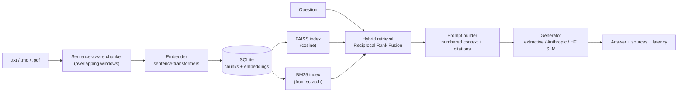

# AskDocs-RAG

A compact, fully tested **Retrieval-Augmented Generation** system: upload `.txt` / `.md` / `.pdf`
documents, then ask questions and get **cited answers** grounded in your files, served over a
**FastAPI** REST API and packaged with **Docker**.

Built to demonstrate the whole RAG lifecycle in plain Python: ingestion, chunking, embeddings,
vector search, hybrid retrieval, prompt design, LLM generation, **evaluation** and deployment.

## Architecture



## Features

| Area | What is implemented |
|---|---|
| Ingestion | `.txt`, `.md`, `.pdf` (pypdf); sentence-aware chunking with overlap; re-ingesting a file replaces it |
| Embeddings | Hugging Face `sentence-transformers` (default `all-MiniLM-L6-v2`), plus an offline hashing embedder for CI |
| Vector search | FAISS `IndexFlatIP` over L2-normalised vectors (= cosine similarity) |
| Lexical search | Okapi **BM25 written from scratch** with an inverted index |
| Hybrid retrieval | **Reciprocal Rank Fusion** of dense and BM25 rankings |
| Storage | SQLite is the source of truth (text + embeddings); FAISS/BM25 rebuilt in memory, no re-embedding on restart |
| Generation | Pluggable: offline extractive baseline, **Anthropic API**, or a local **small language model** via `transformers` |
| Prompting | System prompt forces answers from context only, with `[n]` citations and an explicit "I don't know" fallback |
| Evaluation | hit@k, MRR, keyword accuracy, **groundedness** (hallucination proxy), abstention accuracy, p50/p95 latency |
| Performance | LRU cache for query embeddings, per-stage latency timings returned by the API |
| Serving | FastAPI + Pydantic validation, Dockerfile with layer caching, GitHub Actions CI |
| Tests | 19 pytest tests (chunking, BM25, persistence, retrieval modes, pipeline, eval, API) |

## Quick start

```bash
git clone https://github.com/<your-username>/askdocs-rag.git
cd askdocs-rag
python -m venv .venv && source .venv/bin/activate     # Windows: .venv\Scripts\activate
pip install -r requirements-dev.txt

python -m askdocs ingest data/sample_docs              # index the sample documents
python -m askdocs ask "How can two retrieval rankings be merged?"
python -m askdocs eval -k 3                            # compare dense vs BM25 vs hybrid
python -m pytest -q
```

No GPU or API key is needed. The first run downloads the embedding model (~90 MB).
To run fully offline without that download, use `ASKDOCS_EMBEDDER=hashing`.

### REST API

```bash
python -m askdocs serve            # http://localhost:8000/docs  (interactive Swagger UI)

curl -F "files=@my_notes.pdf" http://localhost:8000/ingest
curl -X POST http://localhost:8000/query -H "Content-Type: application/json" \
     -d '{"question": "What is overfitting?", "k": 4, "mode": "hybrid"}'
```

| Method | Path | Purpose |
|---|---|---|
| GET | `/health` | liveness check |
| GET | `/stats` | indexed documents and chunk count |
| POST | `/ingest` | upload one or more files |
| POST | `/query` | answer + sources + per-stage latency |
| DELETE | `/documents/{source}` | remove a document |

### Docker

```bash
docker build -t askdocs-rag .
docker run -p 8000:8000 -v askdocs_data:/data askdocs-rag
```

### Using a real LLM

```bash
pip install -r requirements-llm.txt
export ANTHROPIC_API_KEY=...                  # Anthropic API
ASKDOCS_GENERATOR=anthropic python -m askdocs ask "What is a context window?"

ASKDOCS_GENERATOR=hf python -m askdocs ask "What is LoRA?"   # local SLM, experimental
```

## Configuration (environment variables)

| Variable | Default | Meaning |
|---|---|---|
| `ASKDOCS_EMBEDDER` | `sbert` | `sbert` or `hashing` (offline) |
| `ASKDOCS_SBERT_MODEL` | `sentence-transformers/all-MiniLM-L6-v2` | any sentence-transformers model |
| `ASKDOCS_GENERATOR` | `extractive` | `extractive`, `anthropic`, `hf` |
| `ASKDOCS_ANTHROPIC_MODEL` | `claude-sonnet-5-5` | model used when generator is `anthropic` |
| `ASKDOCS_HF_MODEL` | `Qwen/Qwen2.5-0.5B-Instruct` | local model when generator is `hf` |
| `ASKDOCS_CHUNK_WORDS` / `ASKDOCS_CHUNK_OVERLAP` | `120` / `30` | chunking window |
| `ASKDOCS_STORAGE_DIR` | `./storage` | where the SQLite database lives |

If you change the embedder, use a fresh storage directory; the app detects a mismatch and refuses to mix vectors from different models.

## Evaluation

`python -m askdocs eval` runs a labelled set (`data/eval/qa.jsonl`: 18 answerable and 4 unanswerable
questions) against the sample corpus and reports, for each retrieval mode:

- **hit@k / MRR**: does the right source appear in the top k, and how high?
- **kw-acc**: share of gold keywords present in the answer (answer-correctness proxy)
- **grounded**: share of answer content words found in the retrieved context (hallucination proxy)
- **abstain-acc**: does the system say "I don't know" on out-of-scope questions?
- **false-abs**: how often it wrongly abstains on answerable questions
- **p50 / p95 ms**: end-to-end latency

Reference run (`ASKDOCS_EMBEDDER=hashing`, extractive generator, k=3, 6 sample documents):

| mode | hit@1 | hit@3 | MRR | kw-acc | grounded | abstain-acc | false-abs |
|---|---|---|---|---|---|---|---|
| dense | 0.94 | 0.94 | 0.94 | 0.89 | 1.00 | 1.00 | 0.06 |
| bm25 | 1.00 | 1.00 | 1.00 | 0.89 | 1.00 | 1.00 | 0.06 |
| hybrid | 1.00 | 1.00 | 1.00 | 0.89 | 1.00 | 1.00 | 0.06 |

> **Read these numbers honestly.** The corpus is tiny and the questions are written for it, so
> scores are high and mostly show that the harness works. The hashing embedder is lexical, so
> BM25 and "dense" behave similarly. Re-run with `ASKDOCS_EMBEDDER=sbert` for semantic
> retrieval, and add your own documents and questions to `data/eval/qa.jsonl` for meaningful
> comparisons.

## Design decisions

- **Hybrid retrieval.** Dense search captures paraphrases; BM25 captures exact terms such as names and numbers. RRF merges them without needing comparable score scales.
- **SQLite as source of truth.** Embeddings are stored next to the text, so restarts rebuild FAISS/BM25 from disk without calling the model again, and re-ingesting a file is a transactional replace.
- **Abstention is first-class.** The prompt and the baseline generator both return a fixed "I don't know" when the context lacks the answer, and the evaluation measures it.
- **Pluggable components.** `Embedder` and `Generator` are small protocols, so swapping models does not touch retrieval code.
- **Lazy model loading.** The API loads the embedding model on first request, keeping import and tests fast.

## Limitations and next steps

- Exact (flat) FAISS search is fine for thousands of chunks; switch to IVF/HNSW for millions.
- Groundedness is lexical; an LLM-as-judge or NLI model would catch subtler hallucinations.
- Possible extensions: cross-encoder re-ranking, query rewriting, streaming responses, tool-calling agent on top of the retriever, authentication on the API.

## Project layout

```
askdocs/
  chunking.py       sentence-aware overlapping chunker
  bm25.py           BM25 inverted index (from scratch)
  embeddings.py     sentence-transformers + offline hashing embedder
  vectorindex.py    FAISS wrapper (NumPy fallback)
  knowledge_base.py SQLite store + hybrid retrieval (RRF)
  generator.py      extractive / Anthropic / HF generators, prompt template
  pipeline.py       retrieve -> generate with latency timings
  evaluation.py     retrieval, grounding and abstention metrics
  api.py            FastAPI app
  __main__.py       CLI: ingest | ask | eval | serve
data/sample_docs/   6 short original documents on ML/RAG topics
data/eval/qa.jsonl  labelled evaluation questions
tests/              pytest suite
```

## License

MIT
